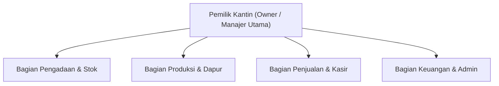
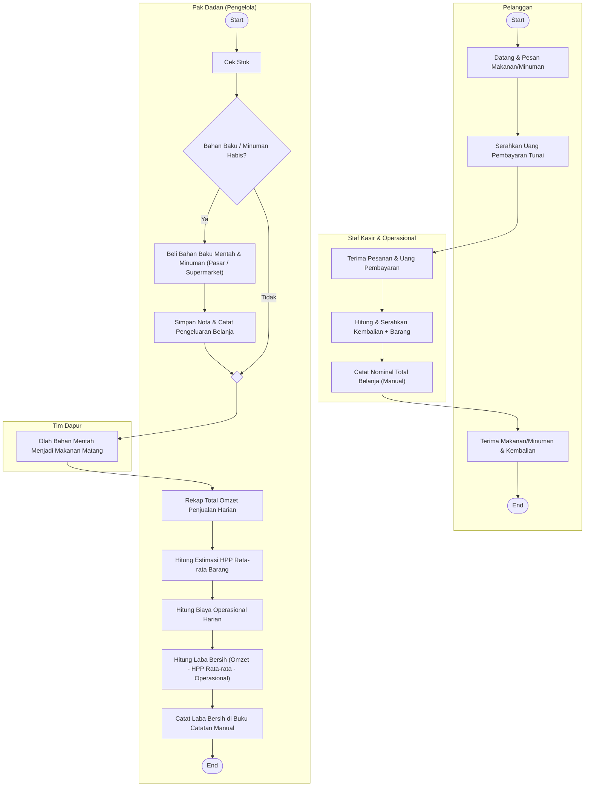

# Pengumpulan Data — Biber Food & Drink

> Catatan konversi: dokumen ini dikonversi dari `Pengumpulan_Data.docx`. Tiga gambar di dokumen asli (struktur organisasi, diagram BPMN, Porter Value Chain) sudah ditranskripsi menjadi teks dan diagram Mermaid. Isi tidak diubah, hanya format.

---

## Organisasi

UMKM (Usaha Mikro, Kecil, dan Menengah)

## Profil

- **Nama:** Biber food & drink
- **Alamat Usaha:** 3MH8+PJX, Jl. Terusan Jakarta Jl. Cikajang Raya, RT.04/RW.22, Antapani Tengah, Kec. Antapani, Kota Bandung, Jawa Barat 40291
- **Telepon/WhatsApp:** 62 882-0022-19529

## Struktur Organisasi

## Tupoksi

### Manajer Utama (Owner)

**Tugas Pokok:**
1. Memantau performa penjualan harian/bulanan melalui sistem.
2. Menyetujui anggaran belanja & pengadaan barang.
3. Mengelola akun pengguna (User RBAC) dan hak akses sistem.
4. Mengevaluasi tingkat efisiensi stok dan keuntungan kantin.

**Input:**
- Otorisasi & Pengaturan Sistem

**Output:**
- Laporan Executive
- Analytics
- Laba/Rugi

### Bagian Pengadaan & Stok

**Tugas Pokok:**
1. Merencanakan daftar belanja harian/mingguan ke pasar.
2. Mencatat data transaksi pembelian (supplier/pasar).
3. Menginput penerimaan barang masuk ke gudang kantin.
4. Mencatat stok retur, barang rusak, atau kedaluwarsa (*spoilage*).

**Input:**
- Nota Pembelian
- Jumlah Barang Masuk
- Stok Rusak

**Output:**
- Laporan Belanja
- Status Stok Bahan

### Bagian Produksi & Dapur

**Tugas Pokok:**
1. Mengolah bahan baku sesuai target porsi harian.
2. Mencatat pengeluaran/pemakaian bahan baku harian.
3. Menjaga standar kebersihan dan pembuangan sisa bahan.

**Input:**
- Pemakaian Bahan Baku
- Hasil Jadi Produk

**Output:**
- Status Ketersediaan Menu Siap Jual

### Bagian Penjualan & Kasir

**Tugas Pokok:**
1. Memproses transaksi penjualan barang/makanan di kasir.
2. Menerima pembayaran (Tunai/E-Wallet/Kupon Kantin).
3. Mencetak struk bukti pembayaran pelanggan.
4. Melakukan penutupan kasir harian (*Cash Closing*).

**Input:**
- Pesanan Pelanggan
- Uang Masuk

**Output:**
- Struk Penjualan
- Laporan Kasir Harian

### Bagian Keuangan & Admin

**Tugas Pokok:**
1. Melakukan rekonsiliasi antara fisik uang kasir dan laporan POS.
2. Mencatat pengeluaran operasional kecil (*petty cash*).
3. Membukukan laporan pemasukan dan pengeluaran harian.
4. Menyusun draft laporan laba/rugi kantin untuk Owner.

**Input:**
- Hasil Kasir
- Bukti Pengeluaran Operasional

**Output:**
- Laporan Cash Flow
- Buku Besar
- Laba-Rugi

---

## Proses

### BPMN

#### A. Pengelolaan Stok & Belanja Harian

Proses pemantauan ketersediaan bahan mentah dan stok minuman hingga pembelian ulang harian ke pasar atau supermarket.

**Aktor:** Pak Dadan (Pengelola), Staf Belanja, Tim Dapur.

**Alur BPMN:**
1. **[Start Event]** Pak Dadan atau Tim Dapur memeriksa stok bahan baku dan minuman secara visual/foto.
2. **[Gateway / Keputusan]** Pengecekan Kebutuhan Stok:
   - **Jika Stok Cukup:** Bahan dan minuman langsung siap digunakan untuk operasional.
   - **Jika Stok Habis/Kurang:** Pak Dadan atau Staf Belanja pergi ke pasar/supermarket.
3. **[Task]** Staf Belanja membeli bahan mentah harian dan stok minuman.
4. **[Task]** Pak Dadan menyimpan nota/struk belanja serta mencatat total pengeluaran belanja.
5. **[Task]** Tim Dapur mengolah bahan mentah menjadi produk makanan matang.
6. **[End Event]** Bahan makanan dan stok minuman siap disajikan dan dijual.

#### B. Transaksi Penjualan Tunai

Proses pelayanan pesanan pelanggan, penerimaan pembayaran tunai, hingga pencatatan nominal belanja.

**Aktor:** Pelanggan, Staf Kasir.

**Alur BPMN:**
1. **[Start Event]** Pelanggan datang dan memesan makanan atau minuman di tempat.
2. **[Task]** Staf Kasir menerima pesanan dan menyampaikan total harga pembayaran.
3. **[Task]** Pelanggan menyerahkan uang pembayaran secara tunai.
4. **[Task]** Staf Kasir menyerahkan produk makanan/minuman beserta uang kembalian kepada pelanggan.
5. **[Task]** Staf Kasir mencatat total nominal belanja harian secara manual pada catatan transaksi.
6. **[End Event]** Pelanggan menerima pesanan dan transaksi selesai.

#### C. Pelaporan Keuangan Harian

Proses rekapitulasi harian omzet dan pengeluaran untuk menghitung estimasi laba bersih operasional bisnis.

**Aktor:** Pak Dadan (Pengelola).

**Alur BPMN:**
1. **[Start Event]** Pak Dadan memulai proses rekapitulasi pada akhir jam operasional.
2. **[Task]** Pak Dadan mengumpulkan total catatan omzet penjualan dan rekap nota belanja harian.
3. **[Task]** Pak Dadan menghitung estimasi Harga Pokok Penjualan (HPP) berdasarkan rata-rata kategori harga barang.
4. **[Task]** Pak Dadan mengkalkulasi total pengeluaran operasional harian.
5. **[Task]** Pak Dadan menghitung laba bersih harian: `Omzet - HPP Rata-rata - Operasional`.
6. **[Task]** Pak Dadan mencatat hasil perhitungan laba bersih ke dalam buku catatan pembukuan manual.
7. **[End Event]** Laporan keuangan harian selesai dicatat.

#### Diagram BPMN (swimlane gabungan, transkripsi dari gambar)

Judul gambar asli: *BPMN Process - Pengelolaan Stok, Penjualan, dan Pelaporan*. Lane: Pelanggan, Staf Kasir & Operasional, Pak Dadan (Pengelola), Tim Dapur.

### Porter Value Chain

Transkripsi dari gambar. Margin di sisi kanan gambar bertuliskan "Mendapatkan profit sebanyak-banyaknya".

#### Support Activities

| Aktivitas | Kondisi di Biber Food & Drink |
| --- | --- |
| Firm Infrastructure | Pembukuan manual di buku catatan, perhitungan laba bersih berbasis estimasi |
| Human Resource Management | Pembagian kerja 3 orang (Pak Dadan, staf kasir, tim dapur) |
| Technology Development | Penggunaan MS Excel untuk master barang, rencana implementasi SI POS & Stok |
| Procurement | Pembelian bahan baku harian ke pasar, belanja ulang stok minuman di supermarket |

#### Primary Activities

| Aktivitas | Kondisi di Biber Food & Drink |
| --- | --- |
| Inbound Logistics | Pembelian bahan mentah; cek stok minuman |
| Operations | Olah bahan matang; penataan produk |
| Outbound Logistics | Penyiapan pesanan makanan & minuman |
| Marketing & Sales | Transaksi tunai langsung; catat total nominal |
| Service | Pelayanan pelanggan di tempat |

---

## Rumusan Masalah

### Stok Barang

- **Tidak Ada Stok Opname Rutin:** Proses stok opname per item tidak berjalan harian karena keterbatasan waktu operasional di lapangan.
- **Pemantauan Stok Masih Manual:** Cek stok produk (seperti minuman) hanya mengandalkan pemantauan visual atau foto ponsel sebelum belanja ulang ke supermarket.
- **Belum Ada Pelacakan Real-Time:** Penggunaan Microsoft Excel terbatas untuk data master barang, bukan untuk mencatat barang masuk dan keluar secara otomatis.
- **Manajemen Bahan Mentah Terpisah:** Bahan makanan mentah dibeli harian sesuai kebutuhan tanpa pencatatan konversi dari bahan mentah ke porsi matang.

### Transaksi Penjualan

- **Pencatatan Item Terjual Absen:** Kasir tidak mencatat rincian item yang dibeli pelanggan saat transaksi berlangsung karena tidak sempat mengejar kecepatan antrean.
- **Hanya Mencatat Nominal Uang:** Kasir sekadar mencatat total uang yang masuk (contoh: Rp20.000) tanpa mengaitkannya dengan detail pesanan.
- **Ketiadaan Teknologi POS/Scanner:** Belum ada perangkat *barcode scanner* atau kasir digital untuk mempercepat input transaksi barang keluar.
- **Penggeneralisasian Harga Barang:** Barang dagangan rentang Rp1.000 – Rp10.000 dipukul rata per kelompok harga, sehingga data kuantitas barang terpakai menjadi tidak akurat.

### Laporan & Keuangan

- **Pencatatan Kertas Manual:** Rekapitulasi transaksi harian masih ditulis tangan pada buku kertas yang berisiko hilang, rusak, atau acak-acakan.
- **HPP Berbasis Estimasi:** Perhitungan Harga Pokok Penjualan (HPP) menggunakan angka rata-rata, bukan nilai pokok aktual per *item*.
- **Laporan Tidak Mencerminkan Nilai Riil:** Margin keuntungan aktual tidak dapat diketahui secara presisi akibat mengabaikan selisih harga antar-produk (seperti selisih Rp100 – Rp200).
- **Proses Rekapitulasi Berulang:** Pengelola harus menghitung ulang omzet, belanja, dan biaya operasional secara manual setiap akhir hari kerja tanpa adanya laporan otomatis.

---

## Temuan

### A. Permasalahan Pengelolaan Stok Barang

#### A1. Belum adanya pencatatan stok masuk dan keluar secara terstruktur

**Kondisi saat ini:**
Pengecekan stok bahan makanan dan minuman masih mengandalkan pengamatan visual atau foto melalui ponsel. Microsoft Excel digunakan untuk menyimpan data master barang, tetapi belum digunakan untuk mencatat setiap pergerakan stok secara otomatis.

**Analisis permasalahan:**
Cara tersebut membuat pengelola harus memeriksa kondisi barang secara langsung untuk mengetahui ketersediaannya. Ketika barang dibeli atau digunakan untuk produksi, jumlah stok aktual belum tentu langsung diperbarui dalam catatan.

Akibatnya, terdapat kemungkinan perbedaan antara jumlah barang yang tercatat dan jumlah barang yang sebenarnya tersedia.

**Dampak yang berpotensi terjadi:**
- Pengelola kesulitan mengetahui jumlah stok secara akurat.
- Barang dapat habis tanpa diketahui lebih awal.
- Pembelian barang berpotensi menjadi kurang efisien.

#### A2. Belum adanya stok opname (penghitungan fisik) rutin

**Kondisi saat ini:**
Stok opname setiap barang belum dilakukan secara rutin setiap hari karena keterbatasan waktu operasional.

**Analisis permasalahan:**
Stok opname merupakan kegiatan menghitung jumlah barang yang tersedia secara fisik, kemudian membandingkannya dengan catatan persediaan.

Ketika kegiatan tersebut tidak dilakukan secara rutin, pengelola akan lebih sulit mengetahui apakah terdapat barang yang hilang, rusak, kedaluwarsa, atau terpakai tetapi belum tercatat.

**Dampak yang berpotensi terjadi:**
- Selisih antara stok fisik dan catatan persediaan sulit diketahui.
- Barang yang perlu segera dibeli berpotensi terlambat terdeteksi.
- Pengelola kesulitan mengevaluasi penyebab berkurangnya stok.

#### A3. Belum adanya pencatatan penggunaan bahan baku untuk produksi

**Kondisi saat ini:**
Bahan makanan mentah dibeli setiap hari sesuai kebutuhan, tetapi belum terdapat pencatatan konversi yang menghubungkan bahan mentah dengan jumlah porsi makanan yang dihasilkan.

**Analisis permasalahan:**
Dalam kegiatan produksi makanan, bahan baku akan berkurang ketika digunakan untuk menghasilkan produk siap jual.

Tanpa pencatatan penggunaan bahan baku, pengelola akan kesulitan memperkirakan berapa banyak bahan yang dibutuhkan untuk menghasilkan sejumlah porsi makanan.

Sebagai contoh, jika satu kilogram beras biasanya menghasilkan 10 porsi nasi, informasi tersebut dapat digunakan untuk memperkirakan kebutuhan beras berdasarkan target penjualan. Namun, tanpa pencatatan yang konsisten, perhitungan tersebut akan lebih sulit dilakukan secara akurat.

**Dampak yang berpotensi terjadi:**
- Perencanaan pembelian bahan baku kurang optimal.
- Penggunaan bahan baku sulit dievaluasi.
- Biaya produksi setiap produk sulit dihitung secara akurat.

### B. Permasalahan Transaksi Penjualan

#### B1. Tidak adanya pencatatan rincian barang yang terjual

**Kondisi saat ini:**
Kasir tidak mencatat setiap item yang dibeli pelanggan ketika transaksi berlangsung karena harus melayani antrean dengan cepat. Pencatatan hanya berfokus pada total uang yang diterima.

**Analisis permasalahan:**
Ketika transaksi hanya mencatat total pembayaran, pengelola memang masih dapat mengetahui jumlah pendapatan, tetapi tidak dapat mengetahui secara langsung produk apa saja yang terjual dan berapa jumlahnya.

Misalnya, dalam satu transaksi pelanggan membayar Rp20.000. Nominal tersebut tidak menjelaskan apakah pelanggan membeli dua makanan seharga Rp10.000, empat minuman seharga Rp5.000, atau kombinasi produk lainnya. Akibatnya, informasi penjualan yang tersedia belum cukup untuk menganalisis performa setiap produk.

**Dampak yang berpotensi terjadi:**
- Produk terlaris sulit diketahui.
- Jumlah barang yang keluar tidak dapat dihitung berdasarkan transaksi secara akurat.
- Pengelola kesulitan menentukan produk yang perlu ditambah atau dikurangi stoknya.

#### B2. Pencatatan transaksi masih berfokus pada nominal uang masuk

**Kondisi saat ini:**
Kasir mencatat nominal uang yang diterima tanpa menghubungkannya dengan rincian pesanan pelanggan.

**Analisis permasalahan:**
Masalah utamanya adalah tidak adanya rincian barang terjual. Sementara itu, masalahnya adalah belum adanya hubungan antara data transaksi dan informasi produk.

Idealnya, satu transaksi memiliki informasi seperti nomor transaksi, waktu pembelian, daftar produk, jumlah masing-masing produk, harga, dan total pembayaran.

Tanpa hubungan tersebut, pengelola hanya memiliki informasi mengenai uang yang diterima, bukan keseluruhan aktivitas penjualan.

**Dampak yang berpotensi terjadi:**
- Riwayat pembelian pelanggan sulit ditelusuri.
- Data penjualan sulit digunakan untuk mengevaluasi produk.
- Pencocokan transaksi dengan perubahan stok menjadi lebih sulit.

### C. Permasalahan Laporan dan Keuangan

#### C1. Perhitungan Harga Pokok Penjualan (HPP) masih berdasarkan estimasi

**Kondisi saat ini:**
Pengelola menghitung estimasi HPP berdasarkan rata-rata harga barang, bukan berdasarkan nilai pokok aktual setiap produk.

**Analisis permasalahan:**
HPP berkaitan dengan biaya barang atau produk yang terjual. Apabila setiap produk memiliki biaya perolehan yang berbeda, penggunaan nilai rata-rata dapat menghasilkan perhitungan yang tidak sesuai dengan biaya aktual produk tersebut.

Misalnya, terdapat dua produk dengan biaya pokok masing-masing Rp2.000 dan Rp3.500. Jika biaya pokok keduanya tidak dibedakan, hasil perhitungan keuntungan setiap produk berpotensi kurang tepat.

Untuk produk makanan yang diproduksi sendiri, perhitungan biaya juga perlu mempertimbangkan bahan baku yang digunakan dan hasil produksi.

**Dampak yang berpotensi terjadi:**
- Keuntungan setiap produk sulit diketahui secara akurat.
- Pengelola kesulitan mengevaluasi harga jual.
- Perbandingan keuntungan antar produk menjadi kurang tepat.

#### C2. Keuntungan aktual UMKM belum dapat diketahui secara presisi

**Kondisi saat ini:**
Dokumen menyebutkan bahwa margin keuntungan aktual sulit diketahui karena perhitungan belum memperhitungkan selisih harga antar produk secara terperinci. Selisih harga yang disebutkan dalam dokumen berkisar Rp100 sampai Rp200.

**Analisis permasalahan:**
Permasalahan ini merupakan dampak lanjutan dari pencatatan penjualan dan perhitungan HPP yang belum terperinci.

Ketika data produk yang terjual tidak tersedia dan biaya pokok hanya diperkirakan menggunakan nilai rata-rata, pengelola akan kesulitan menentukan keuntungan aktual setiap produk.

Perlu dibedakan bahwa omzet bukanlah keuntungan. Omzet merupakan total pendapatan penjualan, sedangkan keuntungan dihitung setelah memperhitungkan biaya yang relevan.

**Dampak yang berpotensi terjadi:**
- Pengelola kesulitan mengetahui produk dengan keuntungan tertinggi.
- Evaluasi harga jual menjadi kurang akurat.
- Keputusan bisnis berisiko didasarkan pada perkiraan, bukan data yang terperinci.

---

## Solusi yang Diberikan (Tujuan)

Solusi yang diusulkan adalah merancang sistem informasi pengelolaan stok, transaksi penjualan, dan laporan keuangan yang terintegrasi untuk mendukung kegiatan operasional UMKM Biber Food & Drink. Sistem ini bertujuan untuk mengurangi ketergantungan terhadap pencatatan manual, meningkatkan ketepatan data, serta membantu pemilik usaha dalam memantau kondisi persediaan dan mengevaluasi keuntungan usaha.

Tujuan pengembangan sistem tersebut meliputi:

- **Meningkatkan akurasi pengelolaan stok barang.** Menyediakan pencatatan barang masuk dan keluar secara terstruktur agar jumlah persediaan dapat dipantau dan diperbarui berdasarkan aktivitas operasional.
- **Mempermudah pemantauan ketersediaan stok.** Membantu pengelola mengetahui barang yang mulai menipis, habis, rusak, atau kedaluwarsa sehingga kebutuhan pembelian dapat direncanakan dengan lebih baik.
- **Mengintegrasikan transaksi penjualan dengan data produk.** Memungkinkan pencatatan setiap transaksi berdasarkan nama produk, jumlah barang yang terjual, harga satuan, dan total pembayaran sehingga informasi penjualan menjadi lebih terperinci.
- **Mendukung pencatatan penggunaan bahan baku.** Membantu menghubungkan penggunaan bahan mentah dengan jumlah produk atau porsi yang dihasilkan agar kebutuhan bahan baku dan biaya produksi dapat diperkirakan dengan lebih tepat.
- **Mengotomatisasi pembuatan laporan penjualan dan keuangan.** Mengurangi proses perhitungan berulang dengan menyediakan rekapitulasi omzet, pengeluaran operasional, harga pokok penjualan (HPP), dan estimasi laba berdasarkan data yang dicatat.
- **Meningkatkan kualitas pengambilan keputusan.** Menyediakan informasi yang lebih terstruktur mengenai produk terlaris, kebutuhan stok, biaya, dan keuntungan sebagai bahan pertimbangan pemilik dalam menentukan kebijakan operasional dan keuangan.
- **Meningkatkan efisiensi operasional usaha.** Mengurangi waktu yang dibutuhkan untuk mencatat, mencari, mencocokkan, dan merekap data sehingga pengelola dapat lebih berfokus pada pelayanan pelanggan dan kegiatan usaha.

---

## Solusi dari Permasalahan

### Solusi Permasalahan Pengelolaan Stok Barang

- **Pencatatan stok masuk dan keluar secara digital.** Sistem menyediakan fitur pencatatan persediaan yang mencatat setiap barang masuk dari pembelian serta barang keluar akibat penjualan, penggunaan produksi, kerusakan, atau kedaluwarsa. Jumlah stok diperbarui berdasarkan transaksi yang tercatat sehingga pengelola tidak perlu melakukan pencatatan terpisah secara manual.
- **Pemantauan stok dan stok opname.** Sistem menyediakan informasi jumlah persediaan terkini serta fitur pencatatan hasil penghitungan stok fisik. Pengelola dapat membandingkan stok aktual dengan stok dalam sistem untuk mengetahui selisih, mengidentifikasi barang yang hilang atau rusak, dan menentukan kebutuhan pembelian ulang.
- **Pencatatan penggunaan bahan baku produksi.** Sistem mencatat jumlah bahan baku yang digunakan untuk menghasilkan makanan beserta jumlah porsi yang dihasilkan. Data tersebut dapat digunakan untuk memperkirakan kebutuhan bahan baku berdasarkan target produksi dan membantu menghitung biaya produksi secara lebih terstruktur.

### Solusi Permasalahan Transaksi Penjualan

- **Penerapan sistem pencatatan transaksi penjualan.** Sistem menyediakan fitur kasir digital untuk memilih produk, memasukkan jumlah pembelian, menghitung total harga secara otomatis, dan mencatat metode pembayaran. Dengan demikian, setiap transaksi memiliki rincian produk yang dibeli, bukan hanya nominal uang yang diterima.
- **Integrasi transaksi penjualan dengan persediaan.** Setiap transaksi penjualan yang berhasil dicatat akan mengurangi jumlah stok produk terkait secara otomatis. Untuk produk makanan yang diproduksi sendiri, pengurangan bahan baku dapat dilakukan melalui pencatatan produksi atau resep bahan baku yang telah ditentukan. Integrasi ini membantu menjaga kesesuaian antara data penjualan dan persediaan.
- **Penyediaan riwayat dan analisis penjualan.** Sistem menyimpan riwayat transaksi berdasarkan waktu, produk, jumlah terjual, dan total pendapatan. Informasi tersebut dapat dirangkum menjadi laporan produk terlaris dan produk dengan tingkat penjualan rendah sehingga pemilik dapat mengevaluasi kinerja penjualan dan merencanakan persediaan.

### Solusi Permasalahan Laporan dan Keuangan

- **Perhitungan HPP berdasarkan data biaya.** Sistem menyediakan pencatatan harga perolehan barang dan biaya bahan baku produksi. Data tersebut digunakan untuk menghitung HPP berdasarkan metode perhitungan yang ditetapkan, sehingga perhitungan tidak hanya mengandalkan rata-rata harga barang. Biaya lain yang relevan dapat dicatat sesuai ruang lingkup sistem.
- **Pembuatan laporan keuangan otomatis.** Sistem mengolah data penjualan, HPP, dan pengeluaran operasional menjadi laporan berkala. Laporan dapat mencakup omzet penjualan, total pengeluaran, estimasi laba, dan arus kas. Otomatisasi ini mengurangi pekerjaan rekapitulasi manual dan risiko kesalahan perhitungan.
- **Penyediaan informasi keuntungan per produk.** Sistem menghubungkan data penjualan dengan HPP untuk memperkirakan keuntungan setiap produk. Pemilik dapat membandingkan kinerja produk berdasarkan pendapatan dan biaya yang tercatat, sehingga evaluasi harga jual, efisiensi biaya, serta strategi penjualan dapat dilakukan dengan lebih terukur.
